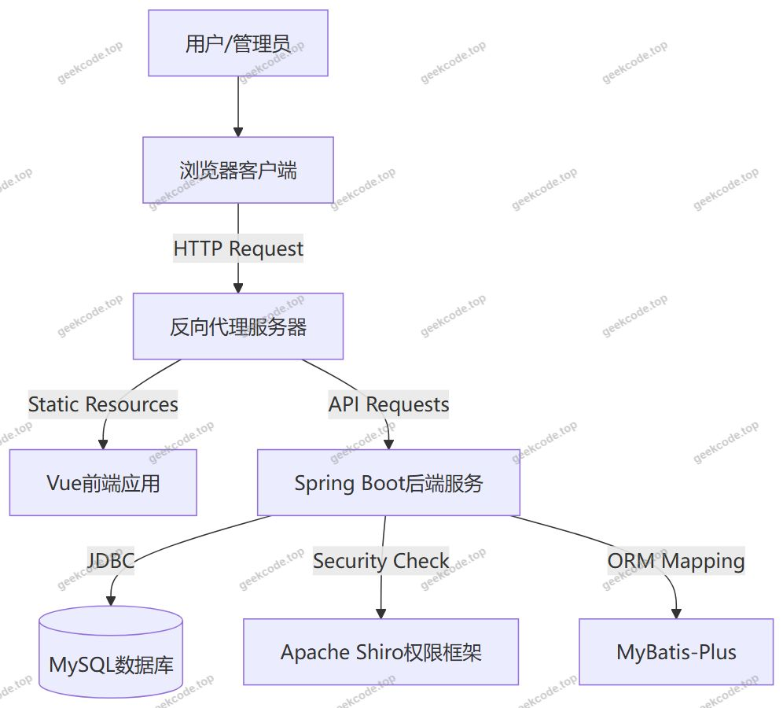

# 基于SpringBoot的人事管理系统

> 🎓 **计算机毕业设计 · 基于SpringBoot的人事管理系统**
>
> 本仓库只放**项目介绍 + 运行截图**（截图是站点带水印的原图，存在仓库 `images/` 里）。
>
> 👉 **完整可运行源码 / 数据库脚本 / 部署文档：[点我获取](https://geekcode.top/archives/%E5%9F%BA%E4%BA%8ESpringBoot%E7%9A%84%E4%BA%BA%E4%BA%8B%E7%AE%A1%E7%90%86%E7%B3%BB%E7%BB%9F?utm_source=github)**
>
> 💬 咨询微信：**ir9372**　|　🌐 更多项目：[极客代码 geekcode.top](https://geekcode.top/?utm_source=github)
>
> 📌 项目详情页：<https://geekcode.top/archives/%E5%9F%BA%E4%BA%8ESpringBoot%E7%9A%84%E4%BA%BA%E4%BA%8B%E7%AE%A1%E7%90%86%E7%B3%BB%E7%BB%9F?utm_source=github>

<table><td width="230" align="center"> <b>扫码加微信 ir9372</b></td><td valign="middle">📦 源码 = 项目介绍 + 全部运行截图 + 数据库 + 部署文档 👉 点上方任意截图，直接跳到 <b>极客代码 geekcode.top</b> 详情页</td></table>

---

<h1>基于SpringBoot的人事管理系统</h1>
<h2>项目概述</h2>

本项目为基于Spring Boot架构的人事管理系统，旨在为企业提供数字化、规范化的内部人力资源全流程管理解决方案。系统采用前后端分离的开发模式，涵盖前台用户交互与后台综合管理两大核心板块。主要功能模块包括员工信息管理、招聘流程处理（简历投递、面试通知）、考勤与请假管理、绩效考核体系、培训记录跟踪以及薪资标准配置等。适用人群主要为企业管理员、人事专员及普通员工。通过集成Shiro权限控制与MyBatis-Plus数据持久层框架，系统实现了高效的数据交互与安全稳定的业务逻辑处理，有效解决了传统人工管理效率低、数据易丢失及权限混乱等问题，提升了企业人事管理的信息化水平。

<h2>技术架构</h2>
<h3>总体架构设计</h3>

系统采用经典的前后端分离架构。前端负责页面渲染与用户交互，后端提供RESTful API接口服务，两者通过HTTP协议进行数据通信。

<h3>核心技术选型理由</h3>
<ol>
<li><strong>后端框架 Spring Boot</strong>：作为核心容器，利用其自动配置和起步依赖特性，简化了XML配置，快速构建微服务或单体应用基础，具备强大的生态整合能力。</li>
<li><strong>持久层框架 MyBatis-Plus</strong>：在MyBatis基础上增强了CRUD操作，提供了通用的Mapper和Wrapper，减少了大量重复SQL编写工作，提升了开发效率，同时保持了对复杂SQL的支持灵活性。</li>
<li><strong>安全框架 Apache Shiro</strong>：用于实现系统的身份认证（Authentication）和授权（Authorization）。相比Spring Security，Shiro配置更简洁，更适合中小型项目的权限模型需求，能有效保护后台敏感路由如<code>/syslog</code>、<code>/config</code>等。</li>
<li><strong>数据库 MySQL</strong>：选用关系型数据库存储结构化的人事档案、考勤记录及日志数据，保证数据的一致性与完整性。</li>
<li><strong>前端技术 Vue.js</strong>：虽然具体前端框架未在依赖列表中显式列出，但根据“vue-integrated”项目类型及路由结构判断，前端采用Vue生态构建单页应用（SPA），以实现流畅的用户体验。</li>
</ol>
<h3>数据库设计要点</h3>

数据库设计遵循第三范式，主要实体包括：

<ul>
<li><strong>人员信息表</strong>：存储用户、员工、人事专员的基本档案。</li>
<li><strong>业务流程表</strong>：包括打卡信息、工作记录、请假申请、加班申请、绩效考核结果等。</li>
<li><strong>配置与管理表</strong>：包括岗位类型、薪酬标准、部门信息、系统配置及操作日志。</li>
<li><strong>招聘相关表</strong>：包括招聘信息、投递简历、面试通知等。
各表之间通过外键关联，例如<code>yuangong</code>（员工）表与<code>bumen</code>（部门）表关联，<code>toudijianli</code>（投递简历）与<code>zhaopinxinxi</code>（招聘信息）关联。</li>
</ul>
<h2>功能模块</h2>

系统功能划分为前台用户端和后台管理端，具体模块如下：

<h3>前台用户端功能</h3>

前台主要面向普通用户、求职者及员工个人，提供自助查询与信息维护服务。

<ol>
<li>
<strong>用户中心 (<code>/index/yonghuCenter</code>, <code>/index/yonghuList</code>)</strong>

<ul>
<li>支持用户注册、登录。</li>
<li>查看和管理个人信息列表。</li>
<li>进入个人中心修改基本资料。</li>
</ul>
</li>
<li>
<strong>人事专员服务 (<code>/index/renshizhuanyuanCenter</code>, <code>/index/renshizhuanyuanList</code>)</strong>

<ul>
<li>人事专员专属入口，查看分配的任务或管理特定区域。</li>
<li>注册成为人事专员账号。</li>
</ul>
</li>
<li>
<strong>员工信息管理 (<code>/index/yuangongList</code>, <code>/index/yuangongDetail</code>)</strong>

<ul>
<li>查看员工公开信息列表。</li>
<li>浏览员工详情页面。</li>
<li>新增员工记录（视权限而定）。</li>
</ul>
</li>
<li>
<strong>招聘与求职 (<code>/index/zhaopinxinxiList</code>, <code>/index/toudijianliList</code>, <code>/index/mianshitongzhiList</code>)</strong>

<ul>
<li><strong>招聘信息浏览</strong>：查看公司发布的职位空缺详情。</li>
<li><strong>简历投递</strong>：填写并提交个人简历至指定岗位。</li>
<li><strong>面试通知</strong>：接收并查看HR发送的面试安排信息。</li>
</ul>
</li>
<li>
<strong>岗位与新闻 (<code>/index/gangweileixingList</code>, <code>/index/newsList</code>)</strong>

<ul>
<li>查看公司岗位分类介绍。</li>
<li>阅读企业内部新闻公告。</li>
</ul>
</li>
<li>
<strong>其他功能</strong>

<ul>
<li><strong>收藏管理 (<code>/index/storeupList</code>)</strong>：管理用户收藏的信息条目。</li>
<li><strong>日志查看 (<code>/index/syslogList</code>)</strong>：部分场景下允许查看相关操作日志。</li>
<li><strong>人事档案 (<code>/index/renshidanganList</code>)</strong>：查看个人电子档案摘要。</li>
</ul>
</li>
</ol>
<h3>后台管理端功能</h3>

后台面向系统管理员和高级人事专员，提供全量的数据管理与配置功能。

<ol>
<li>
<strong>系统基础管理</strong>

<ul>
<li><strong>用户管理 (<code>/yonghu</code>)</strong>：增删改查所有注册用户。</li>
<li><strong>部门管理 (<code>/bumen</code>)</strong>：配置组织架构树。</li>
<li><strong>岗位类型 (<code>/gangweileixing</code>)</strong>：定义职位类别字典。</li>
<li><strong>系统配置 (<code>/config</code>)</strong>：修改网站参数、上传文件路径等全局设置。</li>
<li><strong>操作日志 (<code>/syslog</code>)</strong>：审计所有用户的登录和操作行为。</li>
</ul>
</li>
<li>
<strong>人事核心业务</strong>

<ul>
<li><strong>员工管理 (<code>/yuangong</code>)</strong>：维护在职员工详细信息。</li>
<li><strong>人事专员管理 (<code>/renshizhuanyuan</code>)</strong>：管理HR团队账号及权限。</li>
<li><strong>人事档案 (<code>/renshidangan</code>)</strong>：归档员工入职、转正、离职等全套文档。</li>
</ul>
</li>
<li>
<strong>考勤与假期管理</strong>

<ul>
<li><strong>打卡信息 (<code>/dakaxinxi</code>)</strong>：导入或手动录入员工每日考勤记录。</li>
<li><strong>请假休假 (<code>/qingjiaxiujia</code>)</strong>：审批员工的请假申请。</li>
<li><strong>加班申请 (<code>/jiabanshenqing</code>)</strong>：处理加班报备流程。</li>
<li><strong>考勤信息 (<code>/kaoqinxinxi</code>)</strong>：生成月度/季度考勤报表。</li>
</ul>
</li>
<li>
<strong>绩效与薪酬管理</strong>

<ul>
<li><strong>绩效考核 (<code>/jixiaokaohe</code>)</strong>：执行员工绩效评估打分。</li>
<li><strong>绩效标准 (<code>/jixiaobiaozhun</code>)</strong>：设定KPI指标体系。</li>
<li><strong>薪资信息 (<code>/gongzixinxi</code>)</strong>：发放工资条，记录薪资明细。</li>
<li><strong>薪酬标准 (<code>/xinchoubiaozhun</code>)</strong>：配置不同职级的薪资范围。</li>
</ul>
</li>
<li>
<strong>培训与发展</strong>

<ul>
<li><strong>培训信息 (<code>/peixunxinxi</code>)</strong>：发布培训课程计划。</li>
<li><strong>参加培训 (<code>/canjiapeixun</code>)</strong>：记录员工参训情况。</li>
<li><strong>培训评价 (<code>/peixunpingjia</code>)</strong>：收集学员对培训的反馈评分。</li>
</ul>
</li>
<li>
<strong>招聘管理</strong>

<ul>
<li><strong>招聘信息 (<code>/zhaopinxinxi</code>)</strong>：发布和维护职位广告。</li>
<li><strong>投递简历 (<code>/toudijianli</code>)</strong>：筛选收到的候选人简历。</li>
<li><strong>面试通知 (<code>/mianshitongzhi</code>)</strong>：批量发送面试邀请。</li>
<li><strong>岗位调动 (<code>/gangweidiaohuan</code>)</strong>：办理内部转岗手续。</li>
</ul>
</li>
<li>
<strong>工作记录</strong>

<ul>
<li><strong>工作记录 (<code>/gongzuojilu</code>)</strong>：追踪员工日常工作任务完成情况。</li>
</ul>
</li>
</ol>
<h2>用户角色与权限</h2>

根据代码路由及功能模块分析，系统主要包含以下三类角色，其权限分配如下：

<h3>1. 超级管理员 (Admin)</h3>

拥有系统最高权限，可访问后台所有路由。

<ul>
<li><strong>系统设置</strong>：配置系统参数、管理部门结构、定义岗位类型、查看操作日志。</li>
<li><strong>用户管理</strong>：创建、编辑、删除普通用户、员工及人事专员账号。</li>
<li><strong>全量数据管理</strong>：对所有业务数据（考勤、薪资、绩效、招聘等）拥有增删改查权限。</li>
<li><strong>权限分配</strong>：理论上可通过后台调整其他角色的可见菜单（基于Shiro机制）。</li>
</ul>
<h3>2. 人事专员 (HR Specialist)</h3>

专注于人力资源具体业务的执行者，对应路由 <code>/renshizhuanyuanCenter</code> 及相关业务模块。

<ul>
<li><strong>招聘管理</strong>：发布招聘信息、审核投递简历、安排面试通知。</li>
<li><strong>员工档案</strong>：维护员工基本信息、更新人事档案、处理岗位调动。</li>
<li><strong>考勤与假期</strong>：录入打卡信息、审批请假和加班申请、统计考勤数据。</li>
<li><strong>绩效与培训</strong>：制定绩效标准、执行考核、组织培训并收集评价。</li>
<li><strong>受限权限</strong>：通常不可访问系统底层配置（<code>/config</code>）或删除核心用户账号（除非被特别授权），不能修改薪酬标准的底层规则（视具体策略而定，此处假设仅可查看或录入具体员工薪资）。</li>
</ul>
<h3>3. 普通用户/员工 (User/Employee)</h3>

主要使用前台界面，权限局限于个人数据的查看与维护。

<ul>
<li><strong>个人信息</strong>：注册、登录、修改个人资料、查看个人收藏。</li>
<li><strong>自助服务</strong>：查看自己的考勤记录、提交请假/加班申请、查看自己的薪资信息（若开放）、查看个人培训记录。</li>
<li><strong>招聘参与</strong>：浏览公开招聘信息、投递简历、查看面试通知。</li>
<li><strong>无后台权限</strong>：无法访问任何以 <code>/admin</code> 开头或涉及他人数据的管理路由（如 <code>/yuangong</code> 列表、<code>/gongzixinxi</code> 总表等）。</li>
</ul>

<em>注：具体按钮级细粒度权限需结合前端代码中的 <code>v-if</code> 指令或后端 Shiro 注解进一步确认，上述描述基于模块隔离原则推导。</em>

<h2>项目特色与创新点</h2>
<ol>
<li>
<strong>全流程闭环管理</strong>
系统覆盖了从“招聘-&gt;入职-&gt;考勤/工作-&gt;培训-&gt;绩效-&gt;薪酬-&gt;调岗/离职”的人力资源完整生命周期。通过 <code>/toudijianli</code> 到 <code>/yuangong</code> 再到 <code>/renshidangan</code> 的数据流转，实现了业务链条的无缝衔接，避免了信息孤岛。

</li>
<li>
<strong>灵活的角色权限体系</strong>
引入 Apache Shiro 框架，实现了基于角色和资源的细粒度访问控制。区分了前台自助区与后台管理区，既保证了普通员工隐私数据的隔离，又赋予了HR专员足够的操作自由度，同时确保管理员对系统配置的绝对控制权。

</li>
<li>
<strong>高效的开发与维护架构</strong>
采用 Spring Boot + MyBatis-Plus 组合，极大降低了样板代码的数量。MyBatis-Plus 提供的通用 CRUD 接口使得针对多达20+个业务实体（如 <code>/jixiaokaohe</code>, <code>/peixunxinxi</code> 等）的快速迭代成为可能，提升了系统的可维护性。

</li>
<li>
<strong>数据可视化与审计支持</strong>
内置 <code>/syslog</code> 操作日志模块，能够记录关键业务操作轨迹，满足企业合规性要求。同时，标准化的数据表结构（如 <code>/kaoqinxinxi</code>, <code>/gongzixinxi</code>）为后续接入BI报表工具或进行大数据分析奠定了良好基础。

</li>
</ol>
<h2>部署环境</h2>

为确保系统稳定运行，建议部署环境如下：

<h3>软件环境</h3>
<ol>
<li><strong>Java运行时</strong>：JDK 1.8 或更高版本（推荐 JDK 1.8，兼容性好且稳定）。</li>
<li><strong>数据库</strong>：MySQL 5.7 或 MySQL 8.0。需启用 InnoDB 引擎以支持事务和外键约束。</li>
<li><strong>Web服务器</strong>：Nginx（用于托管前端静态资源及反向代理后端API请求）或 Tomcat（若打包为WAR包部署）。</li>
<li><strong>Node.js</strong>：若前端需本地编译调试，建议安装 Node.js v14.x 或 v16.x 及配套 npm/yarn 包管理器。</li>
</ol>
<h3>硬件建议</h3>
<ul>
<li><strong>CPU</strong>：2核及以上</li>
<li><strong>内存</strong>：4GB RAM 及以上（Spring Boot 应用建议预留至少 2GB 堆内存）</li>
<li><strong>磁盘</strong>：SSD 硬盘，至少 20GB 可用空间（用于存放操作系统、数据库数据及日志文件）</li>
</ul>
<h3>启动步骤简述</h3>
<ol>
<li><strong>数据库初始化</strong>：导入 SQL 脚本，创建库表并插入初始管理员账号数据。</li>
<li><strong>后端部署</strong>：<ul>
<li>修改 <code>application.yml</code> 中的数据库连接 URL、用户名和密码。</li>
<li>使用 Maven 命令 <code>mvn clean package</code> 打包生成 jar 文件。</li>
<li>运行 <code>java -jar xxx.jar</code> 启动后端服务。</li>
</ul>
</li>
<li><strong>前端部署</strong>：<ul>
<li>修改前端 API 请求地址指向后端服务端口。</li>
<li>执行 <code>npm run build</code> 生成静态文件。</li>
<li>将生成的 <code>dist</code> 目录内容放置于 Nginx 根目录下，并配置好 <code>location /api</code> 的反向代理规则。</li>
</ul>
</li>
</ol>
<h2>五、技术特性</h2>
<ul>
<li>前后端集成部署，前端资源打包至后端 static 目录</li>
<li>使用 MyBatis-Plus 简化数据访问层开发</li>
<li>集成 Shiro 权限框架实现角色权限控制</li>
</ul>
<h2>六、功能模块截图</h2>
<h3>前台用户端</h3>
<h4>前台-首页</h4>

<h4>前台-登录</h4>

<h4>前台-用户注册</h4>

<h3>后台管理端</h3>
<h4>后台-操作日志</h4>

<h4>后台-打卡信息</h4>

<h4>后台-登录页</h4>

<h4>后台-工作记录</h4>

<h4>后台-绩效考核</h4>

<h4>后台-培训信息</h4>

<h4>页面-首页</h4>

<h4>后台-员工</h4>

---

## 获取完整源码

| 项目 | 说明 |
| --- | --- |
| 项目名 | 基于SpringBoot的人事管理系统 |
| 运行截图 | 本文 4 张（站点带水印原图，仓库 `images/` 目录） |
| 完整源码 | [https://geekcode.top/archives/%E5%9F%BA%E4%BA%8ESpringBoot%E7%9A%84%E4%BA%BA%E4%BA%8B%E7%AE%A1%E7%90%86%E7%B3%BB%E7%BB%9F?utm_source=github](https://geekcode.top/archives/%E5%9F%BA%E4%BA%8ESpringBoot%E7%9A%84%E4%BA%BA%E4%BA%8B%E7%AE%A1%E7%90%86%E7%B3%BB%E7%BB%9F?utm_source=github) |
| 咨询微信 | **ir9372**（备注：jingpin-yuanma） |
| 更多项目 | [极客代码 geekcode.top](https://geekcode.top/?utm_source=github) |

> 需要源码、部署、改配置、跑不起来等问题，加微信 ir9372 沟通，说明项目名即可。
